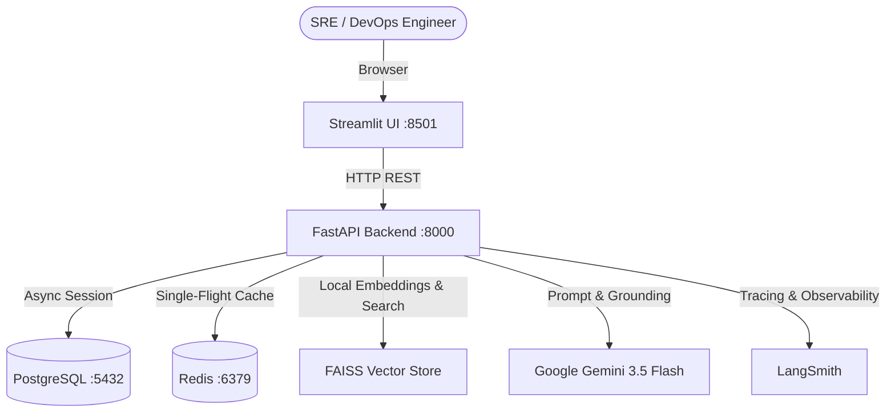

# Incident Copilot 🚨🤖

> **Self-hosted DevOps incident response and grounded post-mortem copilot.**  
> Powered by FastAPI, Streamlit, PostgreSQL, FAISS, Redis, LangSmith observability, and Google Gemini 3.5 Flash.

---

## 🌟 Key Features

- **Incident Triage & Tracking**: Create and track incidents with severity levels (`low`, `medium`, `high`, `critical`) and full message histories.
- **RAG Knowledge Base**: Ingest architectural documents and runbooks (`.md`, `.txt`, `.pdf`). Chunked with section awareness and indexed in-process with SentenceTransformers (`BAAI/bge-small-en-v1.5 (384-dim, CPU)`) and FAISS. Embeddings run locally so infrastructure docs are never sent to a third-party embedding API.
- **Command Safety Guardrails**: Strict whole-command verification against retrieved runbooks. Any unverified shell/CLI command generated by the model is automatically redacted to `[UNVERIFIED COMMAND REMOVED]`. Destructive commands trigger warning indicators.
- **Single-Flight Redis Cache**: Deterministic Q&A caching with SHA-256 keys derived from `kb_version`, model ID, prompt version, and normalized question. Includes an in-memory single-flight lock and a 30-second circuit breaker.
- **Four-Layer Grounded Post-Mortems**:
  1. *Header Table*: Incident metadata, UTC timestamps, and human-readable duration.
  2. *Grounded Sections*: 6 mandatory sections validated with automatic one-time retry and safety guardrail verification.
  3. *Deterministic Timeline*: Chronologically generated table of engineer messages, copilot responses, and resolution summaries (capped at 60 rows with omission notices).
  4. *Audit Footer*: Attribution and safety redaction metrics.
- **Knowledge Loop**: One-click publishing of resolved post-mortems back into the knowledge base, automatically bumping the KB version and invalidating stale answer caches.

---

## 🏗️ Architecture



---

## 🚀 Quickstart

### 1. Prerequisites
- [Docker](https://www.docker.com/) & Docker Compose
- Google Gemini API key ([Google AI Studio](https://aistudio.google.com/))

### 2. Environment Setup
Clone the repository and copy the example environment file:

```bash
git clone https://github.com/Nijjil-Narula/incident-copilot.git
cd incident-copilot

# Linux / macOS
cp .env.example .env

# Windows PowerShell
Copy-Item .env.example .env
```

Edit `.env` and set your credentials:
```ini
GEMINI_API_KEY=your_gemini_api_key_here
GEMINI_MODEL=gemini-3.5-flash
LANGSMITH_TRACING=false
```

### 3. Start the Stack
```bash
docker compose up --build -d
```

### 4. Access Services
- **Streamlit Web UI**: [http://localhost:8501](http://localhost:8501)
- **FastAPI Interactive Docs (Swagger)**: [http://localhost:8000/docs](http://localhost:8000/docs)
- **FastAPI OpenAPI Schema**: [http://localhost:8000/openapi.json](http://localhost:8000/openapi.json)

---

## 🧪 Testing & Verification

Run the 14-point safety guardrail self-test suite in the running API container:

```bash
docker compose exec api python -m app.services.guardrail_selftest
```

---

## 🛡️ Command Guardrail Rules

To eliminate hallucinations during incident response, the copilot executes a whole-command safety pipeline:
1. Shell commands are extracted from runbook chunks (`doc_type=runbook`) inside code fences (` ``` `), `$` prefixes, and inline spans.
2. Candidate commands in model responses are normalized and verified:
   - Must match a complete runbook command exactly.
   - OR match with exactly one leading `sudo ` removed (e.g. runbook `sudo systemctl restart nginx` permits candidate `systemctl restart nginx`).
   - Suffix dropping (e.g. matching `rm -rf /` against `rm -rf /tmp/cache`) is strictly rejected.
3. Destructive commands (e.g. `rm -rf`, `DROP DATABASE`, `mkfs`, `fdisk`) are flagged for visual caution badges.

---

## 📊 Measured Results

- **Cache Miss**: about 3.8s.
- **Cache Hit**: near 0s with 0 tokens.
- **Guardrail**: 14/14 self-test cases passing.
- **Retrieval Threshold**: 0.60 calibrated on on-topic scores 0.69 to 0.84 versus off-topic 0.42 to 0.50.

---

## ⚠️ Limitations

- no authentication;
- single uvicorn worker (in-memory FAISS, locks and the resolve guard rely on it);
- create_all instead of Alembic migrations;
- answers cached globally and prompts carry no chat history;
- the guardrail verifies a command exists in a runbook but not that it suits the situation;
- LangSmith and Gemini receive question and chunk text so tracing is off by default;
- preview Gemini models can return 503s, the model is one env line (GEMINI_MODEL) to swap;
- rate limits are global, not per user;
- the daily LLM cap is stored in Redis on a best-effort basis (eviction or Redis loss resets it) and per-minute windows reset on API restart;
- a post-mortem can use up to 2 LLM calls (one retry if headings are missing), so the 500 daily cap is about 250 resolves in the worst case.

---

## 📄 License
MIT License. See [LICENSE](LICENSE) for details.
